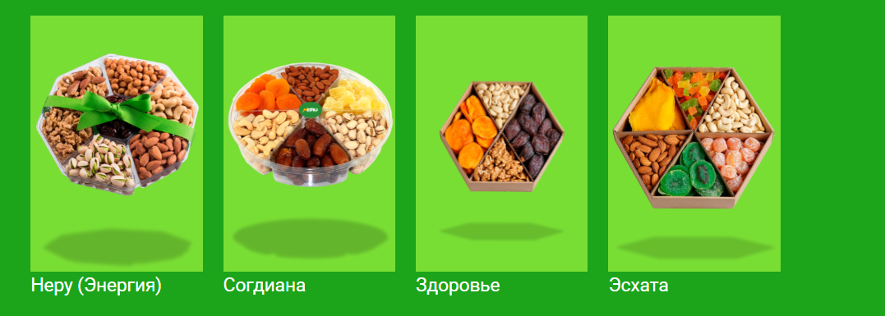
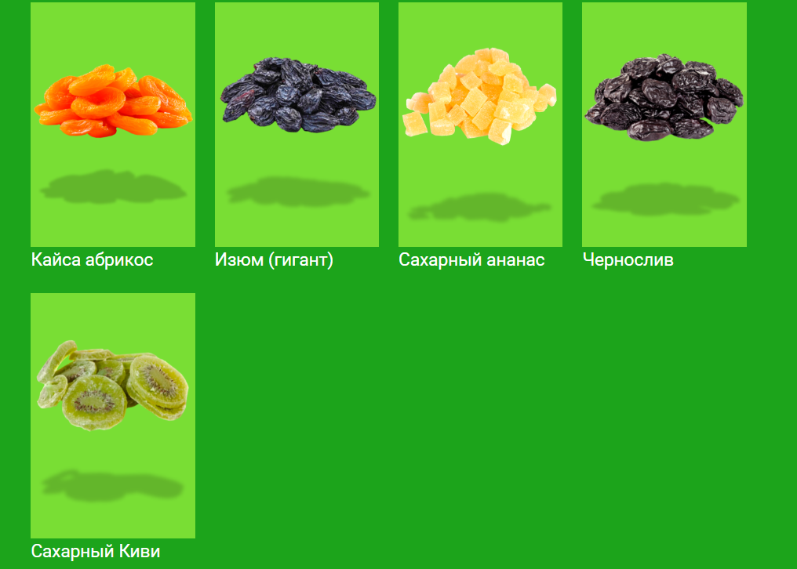
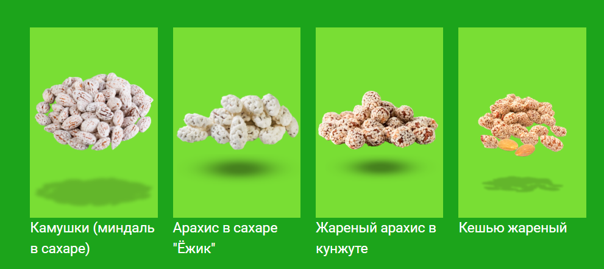
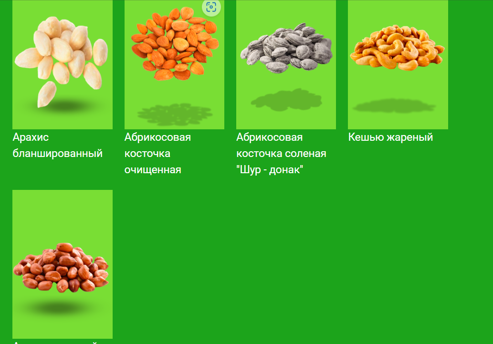
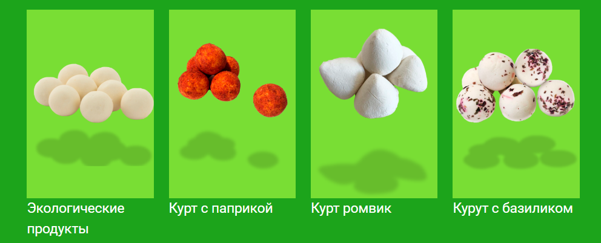

# Каталог по видимым карточкам

Номер указывает положение слева направо, затем сверху вниз. Названия и категории следуют источнику. Цены, масса и состав каждого набора пока неизвестны.

## Подарочные наборы

1. [Неру (Энергия)](cards/gifts-grid-1.png)
2. [Согдиана](cards/gifts-grid-2.png)
3. [Здоровье](cards/gifts-grid-3.png)
4. [Эсхата](cards/gifts-grid-4.png)

## Сухофрукты

1. [Кайса абрикос](cards/fruit-grid-1.png)
2. [Изюм (гигант)](cards/fruit-grid-2.png)
3. [Сахарный ананас](cards/fruit-grid-3.png)
4. [Чернослив](cards/fruit-grid-4.png)
5. [Сахарный Киви](cards/fruit-grid-5.png)

## Сладости

1. [Камушки (миндаль в сахаре)](cards/sweets-grid-1.png)
2. [Арахис в сахаре "Ёжик"](cards/sweets-grid-2.png)
3. [Жареный арахис в кунжуте](cards/sweets-grid-3.png)
4. [Кешью жареный](cards/sweets-grid-4.png)

## Орехи

1. Арахис бланшированный
2. Абрикосовая косточка очищенная
3. Абрикосовая косточка соленая "Шур - донак"
4. Кешью жареный

## Экопродукты

1. Экологические продукты
2. Курт с паприкой
3. Курт ромвик
4. Курут с базиликом

«Экологические продукты» — общая подпись, отдельный товар не установлен. Нижняя подпись на исходнике орехов обрезана. [Фисташки без подписи](../sources/neru-pistachios-reference-02.png) — отдельный визуальный референс. Два варианта написания кешью сохранены в соответствующих разделах.

